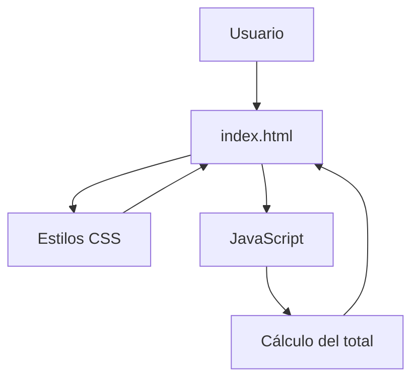

# Tienda TECSUP

Proyecto de práctica desarrollado para el Laboratorio 03 del curso de Diseño de Interfaces de Programación Avanzado.
El proyecto permite visualizar una tienda web y comprobar el funcionamiento de sus estilos y cálculo del total de compra.


## Tabla de contenidos

- [Descripción](#descripción)
- [Instalación](#instalación)
- [Uso](#uso)
- [Funcionalidades](#funcionalidades)
- [Arquitectura](#arquitectura)
- [Tareas pendientes](#tareas-pendientes)
- [Contribuidores](#contribuidores)

## Descripción

Tienda TECSUP es un proyecto de práctica utilizado para comprobar la estructura, estilos y funcionamiento básico de una tienda web.

Al abrir el archivo index.html en el navegador, la página debe mostrar los colores correspondientes al proyecto y presentar en la última línea el total de la compra:

**Total: S/ 68.00**

## Instalación

Para obtener el proyecto, clona el repositorio y accede a su carpeta:

```bash
git clone https://github.com/diegoserruto-bot/tienda-tecsup.git
```

## Uso

Para utilizar el proyecto, abre el archivo index.html directamente en un navegador web.

```text
Abrir index.html → Navegador web → Revisar el total mostrado
```

El resultado esperado en la última línea es:

Total: S/ 68.00

## Funcionalidades

| Funcionalidad                  | Estado        |
| ------------------------------ | ------------- |
| Visualización de la página web | Completado    |
| Aplicación de estilos          | Completado    |
| Visualización de productos     | Completado    |
| Cálculo del total              | En revisión   |
| Corrección de estilos          | En desarrollo |

## Arquitectura

El proyecto utiliza una estructura básica de una página web, donde el archivo HTML contiene la estructura, CSS controla la presentación y JavaScript permite realizar operaciones relacionadas con el funcionamiento de la página.



## Tareas pendientes

- [ ] Verificar que los colores correspondan al diseño solicitado.
- [ ] Comprobar que el total mostrado sea S/ 68.00.
- [ ] Corregir errores encontrados durante las pruebas.
- [ ] Revisar el funcionamiento en diferentes navegadores.

## Contribuidores

| Nombre          | Usuario de GitHub                                        |
| --------------- | -------------------------------------------------------- |
| Diego Alejandro | [@diegoserruto-bot](https://github.com/diegoserruto-bot) |
