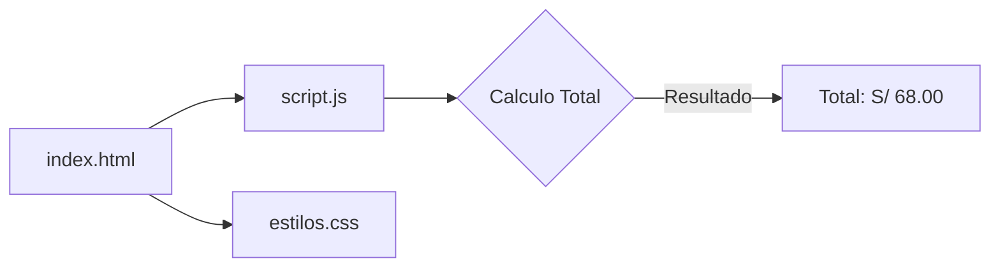

# Tienda TECSUP


Proyecto de práctica para el desarrollo de interfaces avanzadas. Esta aplicación web simula una tienda interactiva con los colores institucionales del curso, permitiendo calcular montos y gestionar un carrito de compras dinámico en tiempo real.

## Tabla de contenidos

- [Instalacion](#instalacion)
- [Uso](#uso)
- [Estado del proyecto](#estado-del-proyecto)
- [Arquitectura](#arquitectura)
- [Contribucion](#contribucion)
- [Licencia](#licencia)

## Instalacion

Para clonar y ejecutar este proyecto de forma local, ejecuta los siguientes comandos en tu terminal:

```bash
git clone https://github.com
cd tienda-tecsup
```

## Uso

El proyecto se ejecuta directamente en el navegador. Puedes abrir la interfaz principal utilizando la siguiente estructura base:

```html
<!-- Abrir directamente en el navegador de tu preferencia -->
<a href="index.html" target="_blank">Iniciar Tienda TECSUP</a>
```

## Estado del proyecto

| Componente              | Estado Actual | Prioridad |
| :---------------------- | :-----------: | --------: |
| Interfaz Base (HTML)    |     Listo     |      Alta |
| Cálculo de Totales (JS) |     Listo     |      Alta |
| Estilos CSS Avanzados   |   En curso    |     Media |
| Persistencia de Datos   |   Pendiente   |      Baja |

### Hoja de ruta

- [x] Diseñar la estructura semántica en `index.html`.
- [x] Crear las funciones de cálculo en `script.js`.
- [ ] Corregir estilos visuales dinámicos en `estilos.css`.
- [ ] Implementar almacenamiento local con `localStorage`.

## Arquitectura



## Contribucion

Si encuentras un comportamiento distinto o quieres proponer una mejora, por favor revisa detalladamente nuestra [guia de contribucion](CONTRIBUTING.md) antes de abrir un Issue o enviar un Pull Request.

## Licencia

Este proyecto está bajo la Licencia MIT. Para más detalles, consulta el archivo [LICENSE](LICENSE).

## Autor

Desarrollado por **Esther Idme Apaza** - [GitHub](https://github.com)

## Autor

Hecho por **Esther Idme Apaza** - Grupo C15 - [GitHub](https://github.com)
