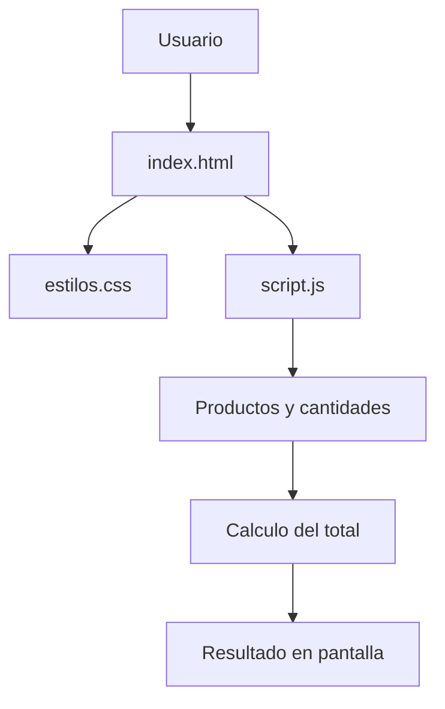

# Tienda TECSUP


## Descripcion del proyecto

Tienda TECSUP es una aplicacion web sencilla que muestra productos, precios, cantidades y el total de un carrito de compras.

Este proyecto se utiliza para practicar HTML, CSS, JavaScript, Git y GitHub, incluyendo la identificacion de errores, el trabajo con ramas y la colaboracion mediante Issues y Pull Requests.

## Tabla de contenidos

- [Instalacion](#instalacion)
- [Uso](#uso)
- [Tecnologias utilizadas](#tecnologias-utilizadas)
- [Estado de las funciones](#estado-de-las-funciones)
- [Hoja de ruta](#hoja-de-ruta)
- [Ejemplos de codigo](#ejemplos-de-codigo)
- [Arquitectura](#arquitectura)
- [Contribucion](#contribucion)
- [Licencia](#licencia)
- [Autor](#autor)

## Instalacion

Clonar el repositorio:

```bash
git clone https://github.com/reneatencio-tech/tienda-tecsup.git
cd tienda-tecsup
```

## Uso

1. Abrir el proyecto en Visual Studio Code.
2. Abrir el archivo `index.html` en un navegador.
3. Revisar los productos disponibles.
4. Observar sus precios y cantidades.
5. Consultar el total calculado del carrito.

## Tecnologias utilizadas

| Tecnologia | Funcion |
|:-----------|:--------|
| HTML5 | Estructura de la pagina |
| CSS3 | Presentacion visual |
| JavaScript | Logica del carrito |
| Git | Control de versiones |
| GitHub | Repositorio y colaboracion |

## Estado de las funciones

| Funcion | Estado | Prioridad |
|:--------|:------:|----------:|
| Mostrar productos | Listo | Alta |
| Mostrar precios y cantidades | Listo | Alta |
| Calcular total con cantidades | Correccion propuesta | Alta |
| Aplicar estilos CSS | Correccion propuesta | Media |
| Agregar nuevos productos | Pendiente | Baja |

## Hoja de ruta

- [x] Crear la estructura HTML.
- [x] Implementar la tabla de productos.
- [x] Agregar el calculo inicial del carrito.
- [x] Identificar errores mediante GitHub Issues.
- [x] Proponer correcciones mediante Pull Requests.
- [ ] Integrar las correcciones en la rama principal.
- [ ] Implementar nuevas funcionalidades.

## Ejemplos de codigo

### HTML: estructura de una tabla

```html
<table>
    <tr>
        <th>Producto</th>
        <th>Precio</th>
        <th>Cantidad</th>
    </tr>
</table>
```

### JavaScript: calculo correcto del total

```javascript
let total = 0;

productos.forEach(function(producto) {
    total += producto.precio * producto.cantidad;
});

console.log("Total:", total);
```

El ejemplo anterior representa la correccion propuesta para calcular el precio considerando la cantidad de cada producto.

## Arquitectura



## Contribucion

Las contribuciones al proyecto se realizan mediante Issues, ramas y Pull Requests.

Consulta el archivo [CONTRIBUTING.md](CONTRIBUTING.md) para conocer las instrucciones de colaboracion.

## Licencia

Proyecto desarrollado con fines academicos.

## Autor

**Rene Percy Atencio Oliva**

Estudiante de TECSUP.

[Mi perfil de GitHub](https://github.com/reneatencio-tech)